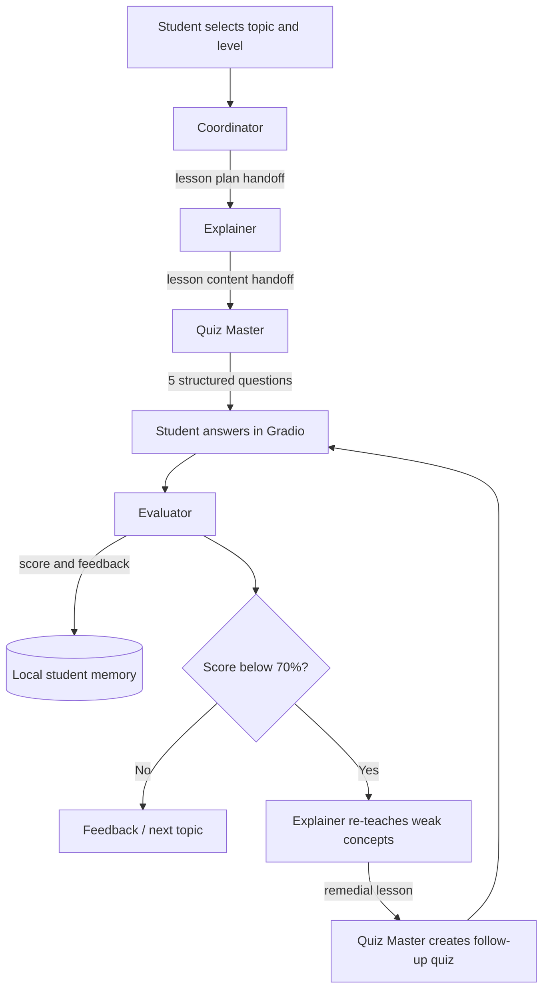
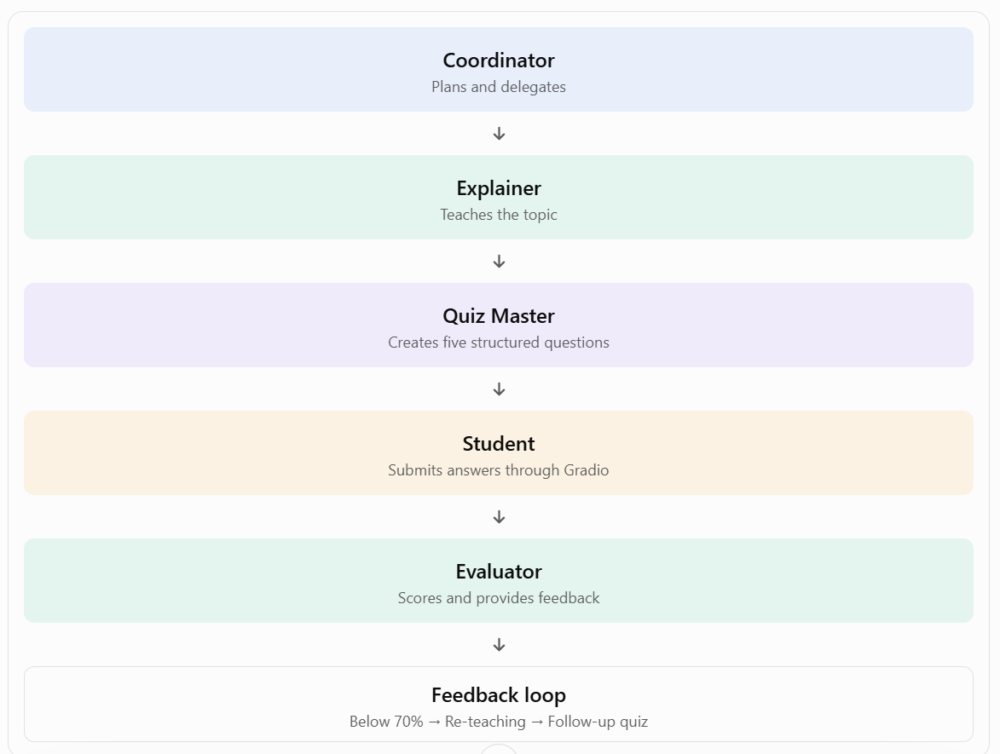

# Leo — Multi-Agent AI Tutor

Leo is a multi-agent study assistant built with **Microsoft AutoGen AgentChat** and **Gradio**. Four distinct agents collaborate: Coordinator, Explainer, Quiz Master, and Evaluator.

## Features

- Gradio is the primary interface; `cli.py` is a lightweight fallback.
- Separate role prompts and behaviours for all four agents.
- Explicit sequential handoffs: Coordinator → Explainer → Quiz Master → Student → Evaluator.
- Structured quiz and evaluation JSON outputs.
- Feedback loop: scores below 70% trigger targeted re-teaching and a follow-up quiz.
- Local student memory remembers studied topics and recent scores.
- API credentials are read from `.env`.

## Architecture



## Agents and role prompts

| Agent | Responsibility | Output / handoff |
|---|---|---|
| Coordinator | Interprets the request, level and learning history; creates lesson plan and handles workflow errors | Lesson plan to Explainer |
| Explainer | Teaches with plain-language steps, examples and recap | Lesson to Quiz Master |
| Quiz Master | Creates five questions in a defined JSON schema | Quiz to student / Evaluator |
| Evaluator | Marks answers, awards partial credit and identifies weak concepts | Structured feedback; sends weak concepts back to Explainer |

Each agent has a dedicated system prompt in `leo/agents.py`.

## Orchestration pattern

Leo uses **sequential orchestration** implemented in Python around AutoGen `AssistantAgent` instances. Each agent receives the previous agent's actual output as part of its next task. This is an explicit handoff, not four independent generations. The application controls the order and has bounded steps. If evaluation is below 70%, the Evaluator's weak-concept report is passed to the Explainer, whose remedial lesson is passed to the Quiz Master for a follow-up quiz.

## Setup (Windows PowerShell)

```powershell
# 1. Create and activate a virtual environment
py -m venv .venv
.\.venv\Scripts\Activate.ps1

# If PowerShell blocks activation, use:
Set-ExecutionPolicy -Scope Process -ExecutionPolicy Bypass
.\.venv\Scripts\Activate.ps1

# 2. Install packages
python -m pip install --upgrade pip
pip install -r requirements.txt

# 3. Create your local environment file
Copy-Item .env.example .env
notepad .env
```

Set your provider API key in `.env`:

```env
BASE_URL=https://api.cheaperinference.com/v1
MODEL_NAME=deepseek-v4.1-flash-1017
API_KEY=your_real_api_key
```

Do not commit `.env`. The `.gitignore` already excludes it.

## Run

Gradio (main UI):

```powershell
python app.py
```

Open the local URL printed by Gradio (normally `http://127.0.0.1:7860`).

CLI fallback:

```powershell
python cli.py
```


## Project structure

```text
leo_multi_agent_tutor/
├── app.py
├── cli.py
├── requirements.txt
├── .env.example
├── .gitignore
├── README.md
├── leo/
│   ├── __init__.py
│   ├── agents.py
│   ├── config.py
│   ├── memory.py
│   └── tutor.py
└── data/
```


## Technology configuration
### Component	Configuration
- Framework:	Microsoft AutoGen
- Main UI:	Gradio
- CLI fallback:	Python
- API:	CheaperInference
- Model:	deepseek-v4.1-flash-1017
- Memory:	Local JSON
- Orchestration:    Sequential handoffs

## Notes and troubleshooting

- The configured endpoint must be OpenAI Chat Completions API compatible. AutoGen documents `OpenAIChatCompletionClient` for compatible endpoints, but provider-specific compatibility should be tested with your account/model.
- If the provider rejects the model name, verify the exact model identifier in your provider dashboard.
- If JSON parsing fails, retry the session; the app reports the issue instead of silently inventing quiz/evaluation data.
- Student memory is a local JSON file and is excluded from Git. It is keyed by the student name; use non-sensitive names or identifiers.
- AutoGen is evolving. This project uses the current AgentChat `AssistantAgent` API and pins minimum package versions rather than relying on the legacy `pyautogen` package.
